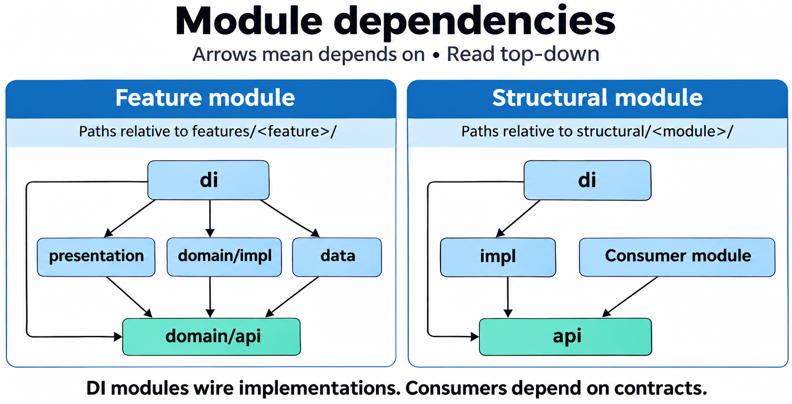

# Compose Sample

An Android sample project that demonstrates a modular architecture with Kotlin,
Jetpack Compose, MVI, and runtime dependency injection. Its goal is to show how
features, structural services, and vendor integrations can evolve behind explicit
contracts while application startup remains centralized and easy to trace.

The project is an architectural reference with illustrative business logic.
`stream` browses TMDB movies and series, with popular titles, recent releases,
upcoming releases, genres, search, details, and trailers. Room supplies previously
loaded content offline. The login feature demonstrates a separate backend token
refresh integration; it does not refresh the TMDB application credential.

## Project structure

```text
app/                         Application startup and top-level Compose host
features/
  stream/
    presentation/            Screens, ViewModels, MVI models, internal navigation
    domain/api/              Business models, repository and use case contracts
    domain/impl/             Use case implementations
    data/                    Repository implementations, data sources, DAOs, entities
    analytics/               Feature-specific tracking contract and implementation
    di/                      Feature bindings and navigation entry point registration
  login/
    domain/api/              Token refresh repository contract
    data/                    Token refresh implementation and HTTP integration
    analytics/               Login tracking
    di/                      Login bindings
structural/                  Structural services and UI infrastructure
build-logic/                 Gradle convention plugins and project configuration
gradle/libs.versions.toml    Dependency coordinates and versions
```

Features include only the layers they need.

Most structural services have three modules:

| Module | Responsibility |
| --- | --- |
| `api` | Contracts and models used by consumers |
| `impl` | Implementation details and platform or vendor adapters |
| `di` | Bindings that connect contracts to implementations |

The foundational `structural/di` service has only `api` and `impl`: it bootstraps the
other modules. `core` and `design-system` keep their main modules alongside their
own `di` modules.

## How modules communicate

### Code dependencies within a feature

In the diagram, `A --> B` means module A depends on module B, rather than runtime
execution order. The feature DI module connects the layers through domain contracts.



The left-hand panel focuses on the feature's business layers; analytics and structural
service dependencies are omitted for clarity.

| Module | What it needs from the other modules |
| --- | --- |
| `presentation` | Models and use case contracts from `domain/api` |
| `domain/impl` | Use case and repository contracts from `domain/api` |
| `data` | Repository contracts and business models from `domain/api` |
| `di` | Contracts and concrete classes from all these layers, so it can register their bindings |

Presentation, domain, and data do not depend on the feature's `di` module.

### Dependencies on structural services

Consumers depend on `structural/<module>/api` and receive contracts through
constructor injection. Reuse these APIs before introducing direct platform or
vendor access. Structural DI modules depend on their own `api` and `impl` to
register bindings; consumers do not import the implementations.

The app can reference implementations needed for startup. Neither a structural
service's `api` nor its `impl` depends on its `di` module.

Gradle dependencies use `implementation` by default, with `api` reserved for
deliberate reexports.

### Calls at runtime

`ObserveCatalogUseCaseImpl` consumes `StreamRepository` from `stream/domain/api`.
`StreamRepositoryImpl` coordinates local and remote data source contracts and
`StreamMapper`, which converts DTOs, cache entities, and domain models. Keep representation conversions
in dedicated mappers rather than implementing them in repositories. Repositories
consume data source contracts rather than querying DAOs or SDK clients directly.
Data source implementations extend
`BaseDataSource`: use `call` for one-shot operations and preserve observable
source flows for continuous updates. `StreamLocalDataSourceImpl` executes Room
operations on its injected I/O dispatcher.

For HTTP integrations, keep vendor clients in structural implementations. Every
HTTP DTO field, including nested fields, declares `network/api`'s `@JsonName` so
protocol names survive obfuscation.

The intended request flow is:

```text
Screen event
  -> ViewModel
  -> Use case
  -> Repository
  -> Local or remote data source
  -> Storage or HTTP client
```

Catalog queries and details observe Room through Flow. Refreshes persist successful
responses before updating the screen; failures preserve previously loaded content.
Search supports an 800 ms debounce and immediate keyboard submission. Stream images
use a private 200 MiB least recently accessed file removal cache with a 30-day refresh age. Room stores only cache metadata; image bytes stay in private files. Posters, backdrops, cast photos and provider logos have separate directories under `cacheDir/media/stream-images`. Trailers require internet.

### TMDB configuration

Add the **API Read Access Token** from your TMDB account to the ignored
`local.properties` file:

```properties
TMDB_READ_ACCESS_TOKEN=your_read_access_token
```

The build also accepts the environment variable `TMDB_READ_ACCESS_TOKEN`, which
takes precedence when nonempty. A trusted GitHub Actions build can inject a
repository secret into that environment variable. Builds without it still compile;
real TMDB requests require a valid credential. Do not expose secrets to fork PRs.

The dedicated TMDB client sends `Authorization: Bearer ...`; it does not use the
login feature's refresh mechanism. Authorization is redacted from HTTP logs.
Credentials embedded in an APK remain extractable, even when the source and CI
configuration are private. This client does not provide a backend secret vault.

The app resource language selects TMDB's `language` query parameter. Results are
cached by media type, query, language and region. Upcoming/recent series identify
the next/latest confirmed event once per series, using available TMDB dates;
the API does not guarantee a complete calendar of future episodes.

This development transition replaces the task database with the stream cache.
Old task rows are removed; encrypted preferences and other app files are preserved.

## Startup and dependency injection

`AppApplication` is the composition root. It explicitly initializes Firebase,
analytics, and push notifications, starts DI, loads structural modules, and then
loads feature modules. Remote configuration initialization is launched explicitly
from the application on an injected I/O dispatcher.

All registrations use the project's `dependencyModule`, `singleton`, `factory`,
qualifier, and resolution contracts from `structural/di/api`. Koin is the current
runtime backend and is confined to `structural/di/impl`.

Binding declarations construct dependencies lazily. They do not implicitly start
SDKs or background tasks. Dispatchers are selected in `core/di` and injected into
components that perform asynchronous work. Activity-bound providers use factories;
singletons must never retain an Activity.

See [runtime DI](structural/di/README.md) for registration, parameters, qualifiers,
and lifecycle-aware ViewModel resolution.

## UI state and navigation

Screens follow MVI:

1. A screen sends a `UiEvent` through `ViewModel.sendEvent()`.
2. The ViewModel calls its dependencies and publishes `UiState` through `StateFlow`.
3. One-off actions are emitted as `UiEffect` through `Flow`, using `sendEffect()`.
4. `BaseScreen.Init()` collects state and effects, calls `Content(uiState)`, and
   forwards effects to `consumeEffect()`.

Each screen keeps its models in a `model` package, its UI in `screen`, and its
ViewModel in `viewModel`. The feature's `NavHost` resolves ViewModels with
`dependencyViewModel()` and passes them to screens. Screen previews use preview
content without DI. Reusable UI components, lifecycle adapters, theme, and dimension
tokens belong in [design-system](structural/design-system/README.md).

Navigation has two levels. `ComposeSampleApp` builds the application `NavHost` from
the shared `NavigationRegistry` and owns the backstack between features. Shared
destination contracts avoid imports of another feature's screens. Each
feature entry point hosts its own `NavHost` and internal backstack. Feature DI
registers entry points during startup, and one entry point supplies the start
destination. The launcher Activity hosts `setContent`; feature screens are Compose
destinations. See [navigation](structural/navigation/README.md).

Static UI text, accessibility labels, and preview copy use string resources.
ViewModels expose messages as `UiText.StringResource(id, vararg params)`; screens
resolve them with the design system's composable `UiText.asString()`. `UiText.Raw`
is reserved for runtime content rather than translatable application copy.

Repository and use case contracts return Flow. Observation stays continuous;
one-shot reads and saves emit one result per collection. ViewModels use the
existing `.onError { ... }.onSuccess { ... }` helpers, with `onSuccess` collecting
the flow. Domain contracts do not expose Room, Android, or DI types.

## Structural services

Each service README describes its contract, DI setup, usage, and implementation
behavior.

| Service | Responsibility |
| --- | --- |
| [Core](structural/core/README.md) | Base ViewModel contracts, utilities, dispatchers, application state aggregation |
| [Network](structural/network/README.md) | HTTP requests, JSON mapping, authentication, connectivity |
| [Local storage](structural/local-storage/README.md) | Encrypted preferences and shared Room database |
| [Session](structural/session/README.md) | Session expiration state |
| [Analytics](structural/analytics/README.md) | Shared event tracking, consumed through feature analytics contracts |
| [Remote config](structural/remote-config/README.md) | Remote configuration |
| [Logger](structural/logger/README.md) | Logging abstraction |
| [Notifications](structural/notifications/README.md) | Local notification delivery |
| [Push notifications](structural/push-notifications/README.md) | Push messaging integration |
| [Permissions](structural/permissions/README.md) | Runtime permission handling |
| [Biometric](structural/biometric/README.md) | Biometric authentication and cryptographic authorization |
| [Camera](structural/camera/README.md) | Camera capture |
| [Media](structural/media/README.md) | Shared media access |
| [Media compression](structural/media-compression/README.md) | Media compression |

Authenticated HTTP clients use stored credentials and the login repository for
token refresh. The refresh service uses an unauthenticated client to avoid recursive
authentication. Session expiration and connectivity feed the application state
aggregator in core. Feature entities and DAOs live in feature data modules; the
shared Room database is assembled in local storage.

## Build and run

Use JDK 17, Android SDK 36, and the checked-in Gradle Wrapper. The minimum supported
Android version is API 26. Configure the SDK through Android Studio or a local,
untracked `local.properties` file:

```properties
sdk.dir=/absolute/path/to/Android/sdk
```

The project defines `dev` and `prd` product flavors. From the repository root:

```sh
./gradlew :app:assembleDevDebug
./gradlew :app:installDevDebug
```

Installation requires a connected device or running emulator. Build configuration,
SDK levels, and placeholder environment URLs are defined in
[`ProjectConfig.kt`](build-logic/src/main/kotlin/br/com/composesample/ProjectConfig.kt).
Configure real backend endpoints before expecting remote business operations to
work. Firebase-backed capabilities also require application Firebase configuration;
see the corresponding service READMEs for initialization and unavailable behavior.

## Development workflow

During initial setup, `main` is the only long-lived branch. Name work branches
`<type>/<short-description>`, using English lowercase kebab-case without issue
numbers.

| Branch example | Purpose | Flow through PRs |
| --- | --- | --- |
| `feature/add-login` | New capability | `main` → `feature` → `main` |
| `bugfix/session-expiration` | Normal development correction | `main` → `bugfix` → `main` |
| `hotfix/login-crash` | Urgent correction to a published version | `main` → `hotfix` → `main` |
| `task/create-login-screen` | Part of a feature or bugfix | Parent `feature` or `bugfix` → `task` → same parent |
| `docs/update-setup-guide` | Independent documentation | `main` → `docs` → `main` |
| `ci/add-pull-request-validation` | Independent CI changes | `main` → `ci` → `main` |
| `refactor/simplify-navigation` | Independent restructuring | `main` → `refactor` → `main` |
| `build/update-gradle` | Build and tooling | `main` → `build` → `main` |
| `chore/add-repository-tests` | Maintenance and standalone test improvements | `main` → `chore` → `main` |

For larger features or bugfixes, merge task PRs into their parent first, validate
its combined behavior, then open the parent PR into `main`. Tasks belonging to a
feature or bugfix follow this flow even when they involve documentation, tests,
or CI.

### Issues and pull requests

Use the [issue forms](https://github.com/lucasrmoro/ComposeSample/issues/new/choose)
and write in English. Describe the problem, scope, affected modules, acceptance
criteria, validation, and dependencies; include reproduction details for bugs.

PR titles use `<branch-type>: <description>`, matching the source branch prefix:
`docs/update-guide` → `docs: update guide`. Fill out the PR template with the
resulting behavior, related issues, affected modules, and validation results.
Use N/A with a reason for irrelevant sections; attach screenshots for visual changes.

The **Validate PR title** check runs after branch validation and reruns when the
title is edited, without requiring a new commit. For `docs/update-guide`,
`docs: update guide` is valid; `fix: update guide`, `docs(guide): update guide`,
and `docs:` are invalid. The check validates format and prefix, not English prose
quality or commit messages.

The **Validate branch name** check validates branch names and PR targets on PR
creation, reopening, updates, and edits. It validates destination types, not a
task's original parent or creation point, and does not prevent branch creation.
Fork runs may require maintainer approval according to the repository's Actions
settings.

CodeRabbit is configured to review new PRs and later pushes, including draft and
task PRs. For this public repository with fewer than ten stars, CodeRabbit
requires a manual trigger: comment `@coderabbitai full review` after opening a
PR and after each push. The `CodeRabbit` check is required by the `main` ruleset
alongside the existing checks; review errors fail it. The **Verify CodeRabbit
approval** check requires approval from `coderabbitai[bot]` on the current
commit. It waits for a submitted review before reporting a result on a new
commit. A separate review ruleset requires two approvals and resolved review
threads for other contributors. Its sole-maintainer bypass does not bypass the
required CodeRabbit checks. Fix findings, push a new commit, and request a new
review. For a false positive, explain the decision in the review thread before
resolving it. If a review fails or its check is missing, request a full review
and inspect the app installation and permissions. Skipped or rate-limited
reviews may pass the `CodeRabbit` check but cannot satisfy the approval check.

Merge PRs using squash, then delete the source branch locally and remotely,
except `main` and `develop`.

### Commits

Use `type: description` in English, without a scope. Commit types are independent
of branch types: `feat`, `fix`, `refactor`, `docs`, `test`, `build`, `ci`, `perf`,
`style`, and `chore`. Examples: `feat: add login` and `fix: handle expired sessions`.
Describe incompatible changes and migration in the PR body and add a
`BREAKING CHANGE:` footer to the commit.

## Validation

```sh
./gradlew :app:testDevDebugUnitTest
./gradlew :app:lintDevDebug
```

The test command runs the app module's local tests. Run the corresponding test
tasks in affected feature or structural modules when changing those modules.

## Reporting security vulnerabilities

Use [private vulnerability reporting](https://github.com/lucasrmoro/ComposeSample/security/advisories/new)
with the affected version, impact, and safe reproduction steps. Keep vulnerabilities,
credentials, and personal data out of public issues. Exposed credentials must be
revoked or rotated. If private reporting is unavailable, wait for a private channel.
